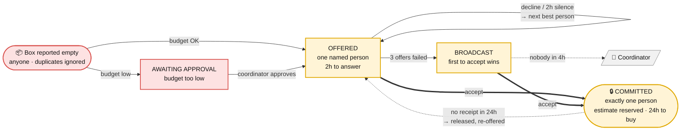
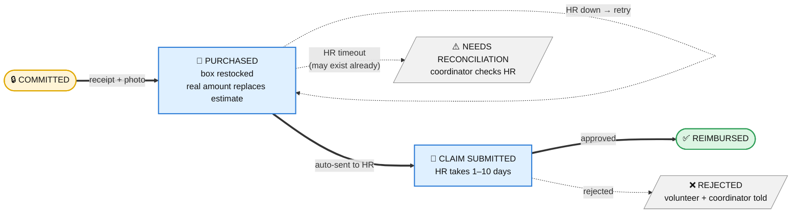

# Snack Counter Automation: Design

**Goal:** the box is refilled quickly, by exactly one person, chosen fairly. They get their money back without chasing it, and management sees one monthly number.
**My read of the root cause:** the process has no owner and no timer. "Someone will do it" means nobody does, and sometimes two people do. So the core of the design is **one named owner per refill, with a deadline**.

## 1. A refill from "empty" to "reimbursed"

**Phase A: get exactly one named owner** (the box is empty)

**Phase B: get the volunteer paid** (the box is full again)

Thick arrows are the happy path; dotted arrows are failure paths. 🟥 box empty · 🟨 finding one owner · 🟦 money in flight · 🟩 done · ⬜ a human steps in.

## 2. Main parts and the data each keeps

| Part | Keeps | Notes |
|---|---|---|
| **Refills** (`snackService`, `refillStore`) | Refill: office, state, version, who was offered/passed over, who committed, deadlines, purchase, claim record | Owns the lifecycle. Invariant: at most one *active* refill per office. |
| **Roster** (`roster`) | Volunteers (employee id, home office, active) and daily check-ins per office | Availability comes from chat check-ins. Visitors check in at the office they're visiting. |
| **Budget** (`budget`) | Monthly budget + typical refill estimate per office | Spend is *derived* from refills, never stored twice. |
| **Claims** (inside the service) | HR claim id, status, attempts, last error | One claim per refill. |
| **Reporting** (`report`) | Nothing. A read model over refills + FX rates. | Records every FX rate it used. |
| **Ports** | `ChatPort`, `HrPort`, `FxRates`, `Clock` | Simulated by `FakeChat`, `FakeHr`, `FixedFxRates`, `FakeClock`. |

These are modules in one process, with **service-ready boundaries**. Each owns its data and talks through narrow interfaces. Splitting them into services later is mechanical: Refills, Roster and Claims would talk via events, and Reporting would read from them.

## 3. How each problem is prevented

| Problem | Mechanism | Proven by test |
|---|---|---|
| Box sits empty for days | One named person asked first, with a 2h answer window. Then the next person, then a broadcast, then the coordinator. Timeouts also cover "accepted but never bought" (24h). | `lifecycle.test.ts` → "handed to someone else" block |
| Two people buy the same day | One active refill per office (a filtered unique index in SQL). Accepting is a compare-and-set on the refill's version, so the loser is told "Already taken by X". Duplicate "empty" reports return the same refill. The office channel is told who is buying. | "two people cannot both commit" block |
| Same few people refill and wait weeks | Ranking: least money still owed to them → fewest refills in the last 30 days → longest since their last refill. The claim goes to HR the moment the receipt is uploaded. Claim status is polled. The volunteer is told when it's approved, and the coordinator is nudged at 10 days or on rejection. | `selection.test.ts`, `claims.test.ts` |
| Nobody knows spend / what's eaten | Every purchase is stored in its original currency, with optional snack tags. The monthly report shows spend vs budget per office, a grand total in NOK, refills per person, average hours the box was empty, and claims still outstanding. | `budget-and-report.test.ts` |

**Money rules:**
- Amounts are integer minor units (øre/paise) and never floats. Adding NOK to INR throws.
- Spend counts against the office where the snacks are, in that office's currency.
- HR receives the receipt currency and converts to the person's payroll currency itself.
- The month is the purchase date *in the office's time zone* (Oslo and Bengaluru months start at different moments).
- The report converts each purchase at the rate for its own date.

**Reliability:**
- If HR is unavailable, nothing was created, so we retry on the next tick.
- If HR times out, a claim may already exist. Retrying could pay twice, so we stop and ask the coordinator to check HR using our reference.
- All time comes from an injected clock, so tests are deterministic and need no sleeps.

## 4. Trade-offs

- **Direct asking vs. "who can go?":** direct asking is slightly pushier, but it's the only thing that beats the bystander effect. People can decline in one click, and it falls back to a broadcast.
- **Check-in for availability:** this is cheap and works without a calendar or leave integration. The cost is that someone who forgets to check in isn't asked, which is the safe failure.
- **Budget soft-block:** we require approval *before* a refill when the budget is low, and only *flag* an overspend after purchase. The money is already spent by then, and the volunteer must still be reimbursed.
- **Spend derived, not stored as a running total:** this means a scan per check. Refills number about 10 per month per office, so it's free, and reservations can never drift out of sync.
- **No clever data structures:** with 35 volunteers, a sort is O(n log n) on n ≤ 20. A heap or cache would add stale-state bugs and win nothing.
- **In-memory store:** the guarantees (unique active refill, compare-and-set) are written to map 1:1 onto SQL Server: a filtered unique index and `UPDATE … WHERE Version = @v`.

## 5. Deliberately not built

- **Receipt OCR.** Error-prone. The volunteer types the amount, and HR sees the image.
- **Stock sensors / smart shelves.** Hardware costs more than the problem. "Box is empty" is one chat command.
- **Item-level consumption analytics.** Tags plus refill frequency answer "what gets eaten" well enough.
- **Real chat bot, HR integration, UI, auth, database, scheduler, live FX feed.** These are ports with fakes, as the brief asks.
- **Approval workflows, payment to vendors, company cards.** Worth raising: a company card per office would remove reimbursement entirely. That's a policy change, not software.

## 6. Assumptions (sent to Framsikt; no reply before the deadline)

1. Low budget → coordinator approves. No rollover.
2. Month = purchase date in office local time.
3. Report in NOK, at the rate on the purchase date.
4. Visitors are charged to the visited office; HR converts currency.
5. HR returns a claim id and status can be polled. Claims can be rejected. No idempotency key on HR's side.
6. No presence source, so volunteers check in via chat.
7. Directly asking one person is acceptable.
8. One coordinator per office.
9. Item-level tracking is not needed.
10. "Volunteer pays, then claims" is fixed.
